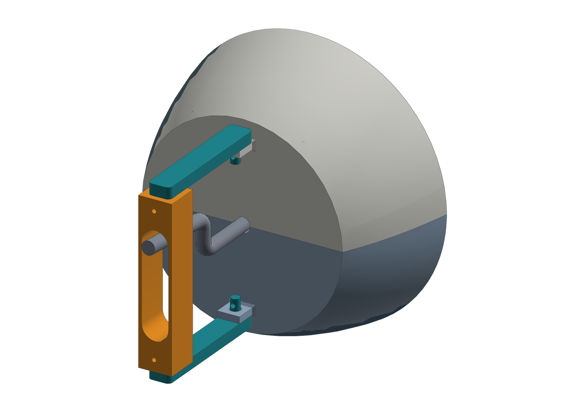
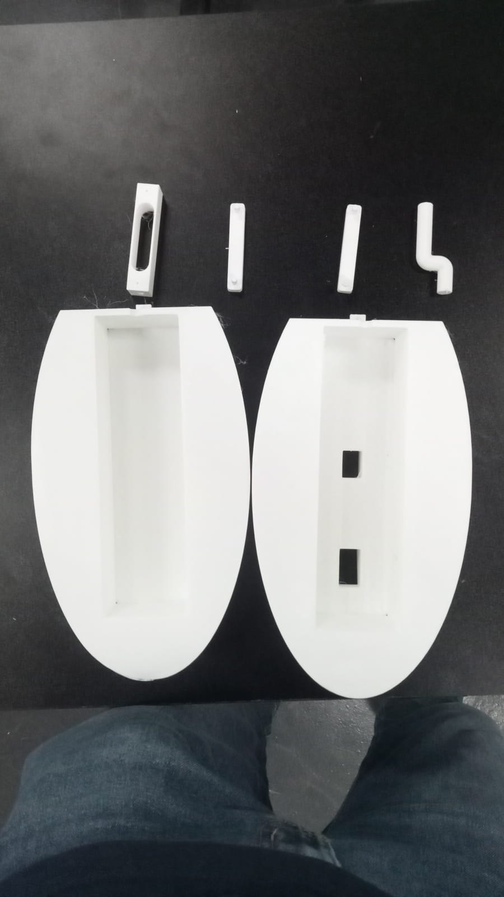

<section class="hero" aria-labelledby="top">
  

    <h1 id="top">Mecha4</h1>
    
A 3D-printed robotic fish. One motor wags the tail through a crank and a slotted yoke, a rudder on top steers, and two side fins set the depth. You drive it from a phone.

    <dl class="facts">
      <dt>Length</dt><dd>224 mm</dd>
      <dt>Body diameter</dt><dd>130 mm</dd>
      <dt>Tail swing</dt><dd>18 mm each side</dd>
      <dt>Actuators</dt><dd>1 DC motor, 3 servos</dd>
      <dt>Control</dt><dd>Phone, ESP32, HC-12 radio, Arduino UNO</dd>
    </dl>
    
MEC 482 Mechatronics, Abu Dhabi University, Fall 2026 Instructor: Dr. Claudio Vignola Team: Basil Ahmed, Talha, Hamad

  

  <figure class="tank">
    <model-viewer src="assets/model/robotic-fish.glb" poster="assets/img/assembly-rear.png" alt="3D model of the robotic fish with its tail mechanism moving" camera-controls autoplay animation-name="TailWag" camera-orbit="-35deg 68deg auto" field-of-view="21deg" shadow-intensity="0.5" exposure="1.05" interaction-prompt="none" touch-action="pan-y"></model-viewer>
    <figcaption>Drag to turn the model. The tail goes through one crank turn every 1.2 seconds.</figcaption>
    <ul class="legend" aria-label="Part colours">
      <li>Body halves</li>
      <li>Crank rod</li>
      <li>Slotted yoke</li>
      <li>Link bars</li>
      <li>Rudder</li>
      <li>Side fins</li>
    </ul>
  </figure>
</section>

## Introduction

Mecha4 is a small robotic fish built for MEC 482 Mechatronics. The body is an egg-shaped shell printed in two halves that hold the electronics. Behind it, a DC motor turns a bent crank rod that rides in the slot of a yoke. The yoke hangs from the body on two link bars, so every turn of the motor swings the tail frame 18 mm to each side. A servo-driven rudder on top steers the fish, and two servo-driven side fins tilt it up or down.

The fish is driven from a phone. A gamepad app sends button presses over Bluetooth to an ESP32, which forwards them over a 433 MHz HC-12 radio to an Arduino UNO inside the fish. The UNO switches the motor through a relay and moves the three servos.

## Research Question

* Can a single DC motor, a crank and a slotted yoke give a low-cost 3D-printed fish a steady side-to-side tail beat?
* Can one rudder servo and two fin servos give separate control of heading and depth?
* Can a phone, an ESP32 and a 433 MHz radio link control the fish reliably, and stop it safely when the signal drops?
* Can the whole fish be built for 100 to 200 AED?

## Background

Most fish swim by bending the rear of the body and sweeping the tail fin from side to side. This pushes water backwards and the fish forwards. Robotic fish copy this in different ways: soft bodies driven by pumps, chains of servos, or a single motor with a linkage. We chose the single-motor linkage because it needs only one actuator for thrust and keeps the tail beat regular.

The linkage is a scotch yoke. The crank pin moves in a circle, but the slot only lets the yoke follow its sideways movement, so the yoke slides left and right while the pin slides up and down in the slot. Steering and depth are handled separately by the rudder and the side fins. Reference 3 describes a similar use of servo-driven side (pectoral) fins.

<figure class="render">
  
  <figcaption>The tail drive. The crank rod comes out of the back of the body and runs through the slot in the yoke. Two link bars pin the yoke to tabs on the body.</figcaption>
</figure>

[See how each part works](how-it-works.html)

## Results

  <figure>
    
    <figcaption>First prints: both body halves, the yoke, the two link bars and the crank rod.</figcaption>
  </figure>
  <figure>
    <video controls muted playsinline preload="none" poster="assets/video/bench-test-1.jpg">
      <source src="assets/video/bench-test-1.mp4" type="video/mp4">
    </video>
    <figcaption>Bench test of the electronics, driven from the phone gamepad.</figcaption>
  </figure>

1. The new body was modelled in Inventor and printed: two halves, 224 mm long and 130 mm in diameter, with windows for the servos and tabs for the tail linkage.
2. The tail parts were printed: the crank rod with an 18 mm throw, the 73 mm slotted yoke and two link bars with pins 50 mm apart.
3. The control chain works on the bench: phone gamepad, ESP32, HC-12 radio and Arduino UNO driving the servos.
4. The UNO stops the motor and centres every servo if it hears nothing from the controller for 1.5 seconds.
5. Swimming speed, turning and leak tests: *to be added after assembly and water testing.*

## Conclusions and Future Work

The fish has been reduced to one motor and three servos, and the control link works from a phone. The next steps are to assemble the printed parts with the electronics, seal the joint between the body halves, and test the fish in water. We will measure swimming speed, turning radius and how well the fins change depth.

One limit to test early: radio signals at 433 MHz travel only a short distance through water, so the fish may need to stay at the surface, or keep its antenna above water, to stay in contact.

## External Links

* [How it works: tail drive, rudder and fins](how-it-works.html)
* [Electronics and code](electronics.html)
* [Build log with photos and videos](build-log.html)
* [Files: STL parts and Arduino code](files.html)
* [Source on GitHub](https://github.com/Kr1-b/Mecha4.github.io)
* [DabbleESP32 library (phone gamepad)](https://github.com/STEMpedia/DabbleESP32)
* [AltSoftSerial library (radio on the UNO)](https://github.com/PaulStoffregen/AltSoftSerial)

## References

1. van den Berg, S. C., Scharff, R. B. N., Rusák, Z. and Wu, J. "OpenFish: Biomimetic design of a soft robotic fish for high speed locomotion." *HardwareX*, 2022. [TU Delft record](https://research.tudelft.nl/en/publications/openfish-biomimetic-design-of-a-soft-robotic-fish-for-high-speed-)
2. "A low-cost and open-source robotic fish using 3D printing technology." University of Limerick. [University of Limerick record](https://pure.ul.ie/en/publications/a-low-cost-and-open-source-robotic-fish-using-3d-printing-technol/)
3. "Scalable Dual-Servo Pectoral Fin Platform for Biomimetic Robotic Fish." *Machines* 14(1), 121, 2026. [MDPI](https://www.mdpi.com/2075-1702/14/1/121)
